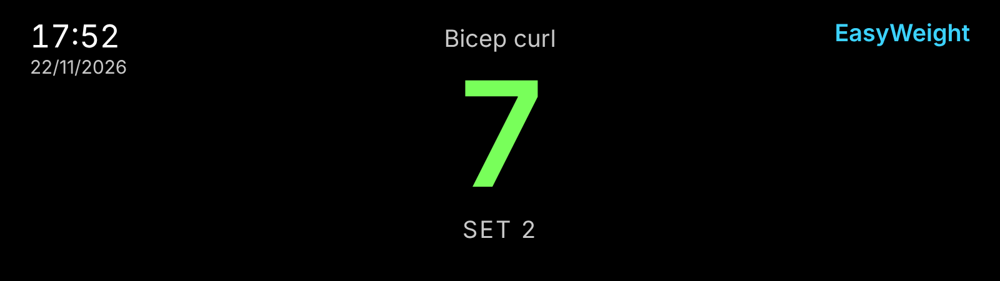
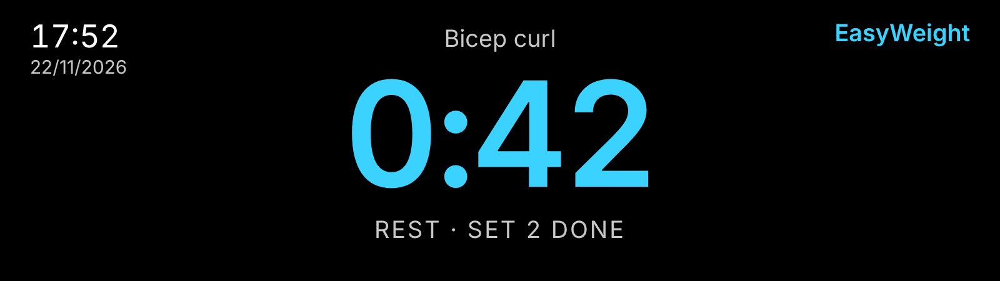
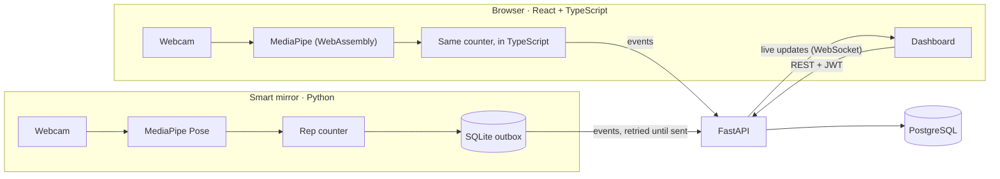

<div align="center">

# EasyWeight

**A smart gym mirror that counts your reps.** A webcam and a pose model watch you train, recognize the exercise, count every rep, coach your form and time your rest, and the numbers float on the glass. Every rep reaches the cloud as it happens, and a web app shows your training live or turns any laptop or phone into the mirror.

[](https://easyweight.onrender.com)
[](https://github.com/grg1582/EasyWeight/actions/workflows/device.yml)
[](https://github.com/grg1582/EasyWeight/actions/workflows/backend.yml)
[](https://github.com/grg1582/EasyWeight/actions/workflows/web.yml)
[](LICENSE)

</div>

https://github.com/user-attachments/assets/cbb6c348-219c-41a6-bf49-df96ef5d7411

## Try it

Open **[easyweight.onrender.com](https://easyweight.onrender.com)** and press **Try the demo**: an account with two months of simulated workouts, no sign-up needed. Then open **Train**, allow the camera, and do a few bicep curls, lateral raises, overhead presses or squats (or push-ups, side on to the camera). The pose model runs in your browser, so the video never leaves your device.

| On the mirror, or in the browser | After 8 seconds without a rep |
|:---:|:---:|
|  |  |

<picture>
  <source media="(prefers-color-scheme: dark)" srcset="Images/dashboard-dark.png">
  
</picture>

## Highlights

- **Computer vision that knows what you're doing.** MediaPipe pose landmarks become joint angles and heights, and a state machine counts reps of five exercises: curls, lateral raises and overhead presses arm by arm, squats and push-ups for the whole body. The first rep of a set decides the exercise, posture tells standing from lying down, 8 seconds of stillness starts a rest timer, and a sip of water during the rest isn't counted as a curl. Readings are steadied against jitter, frames where a joint is lost, different frame rates and standing side on. [How the counting works](docs/how-counting-works.md)
- **Exercises are data, not code.** Each exercise is a definition of which joints to measure, where a rep starts and ends, the posture it needs and what the coach says. Adding one doesn't touch the counting logic.
- **A coach, not just a counter.** A rep that stopped halfway gets "Curl all the way up", sagging hips in a push-up get "Keep your body in a straight line", reps too fast to control the weight get "Slow down", right under the count. In the rest after each set it sums the set up ("10 reps · 2 partial") and says what to do on the next one, or gives a form tip for the exercise after a clean set.
- **Live, and set up with a QR code.** Every rep reaches your open dashboards within a second over a WebSocket. A new mirror shows a QR code: scan it with your phone and it's connected, with no password typed on the mirror and its token never leaving it.
- **One counting logic, two languages.** The mirror runs it in Python, the browser in TypeScript. A cross language parity suite plays the same synthetic sessions through both and requires the exact same reps, sets and events.
- **Works offline, never double counts.** The mirror writes every event to a local SQLite outbox and sends it when the network is back. Each event carries its own id, so retries are harmless, and each gets its own result, so one bad event never blocks a backlog.
- **Security done properly.** Argon2 password hashes, short-lived JWTs with rotating refresh tokens that detect reuse, hashed device tokens, rate limited sign-in, and other users' data that answers "not found", not "forbidden".
- **Tested and shipped.** 200+ automated tests: pytest against a real PostgreSQL, Vitest component tests, and Playwright end-to-end tests that sign up, add a mirror and train with a fake camera in a real browser. GitHub Actions runs all of them on every push, and Render deploys `main` from a single Blueprint.

## How it fits together



| Part | Built with |
|------|------------|
| Mirror app | Python, MediaPipe, OpenCV, SQLite outbox with retries |
| API | FastAPI, SQLAlchemy, Alembic, PostgreSQL, JWT with refresh tokens, Argon2 |
| Web app | React, TypeScript, Tailwind, TanStack Query, Recharts, MediaPipe in WebAssembly |
| Tests | pytest on a real PostgreSQL, Vitest, Playwright |
| Delivery | Docker, Docker Compose, GitHub Actions, Render, Neon, Sentry |

## Run it yourself

The whole system (database, API and web app) in one command:

```bash
docker compose up --build
```

Then open http://localhost:8080 for the web app, or http://localhost:8000/docs to try every API endpoint.

The mirror app runs on any computer with a webcam. Connect it to your account by scanning a QR code, then train:

```bash
cd device
pip install -e .
python -m easyweight.pair --name "Home mirror"
python -m easyweight
```

Contributing? See [CONTRIBUTING.md](CONTRIBUTING.md) for the architecture, the project structure and how to run every test.

## Documentation

| | |
|---|---|
| [How the counting works](docs/how-counting-works.md) | The five exercises, where the camera should be, the set and rest logic, steadying the readings, the coach, adding an exercise, and the tuning constants |
| [The mirror app](docs/mirror-app.md) | Setup, options, recording and replaying sessions, connecting the mirror by QR code |
| [Backend and API](docs/backend.md) | Every endpoint, how events, sign-in, live updates and QR pairing work, and deploying |
| [Web app](docs/web.md) | The dashboard, live updates, and training in the browser |
| [Contributing](CONTRIBUTING.md) | The architecture, the project structure, setting up and running every test |

## Hardware

The mirror is a monitor behind a two-way mirror, with a webcam on top. The screen is black except for the text, and behind the glass the black is invisible, so only the numbers appear.


## License

[MIT](LICENSE)

The screen text uses the [Inter Display](https://github.com/rsms/inter) font
(`device/easyweight/fonts/InterDisplay-SemiBold.ttf`), included under the SIL Open Font License
1.1. See [Inter-LICENSE.txt](device/easyweight/fonts/Inter-LICENSE.txt).
