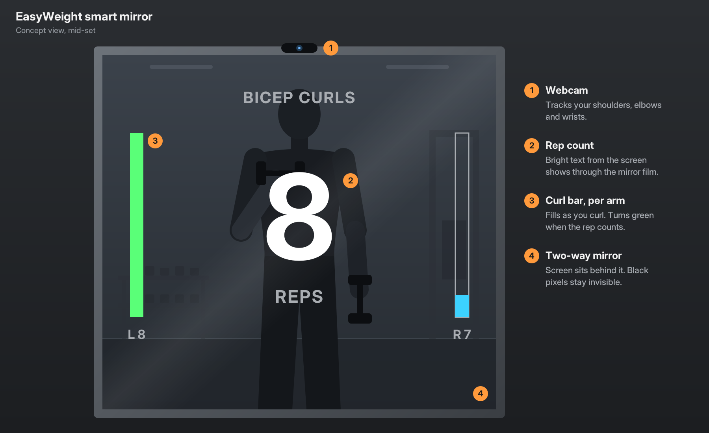

https://github.com/user-attachments/assets/91137fd0-7c6d-441a-8846-efb7e68ecccd


# EasyWeight

A bicep curl counter for a smart mirror. It watches you through a webcam,
counts your curls, and shows the count as bright text on a black screen.
Behind a two-way mirror the black is invisible, so only the numbers appear to
float on the glass.




## How it works

[MediaPipe Pose](https://ai.google.dev/edge/mediapipe/solutions/vision/pose_landmarker)
finds your shoulders, elbows and wrists in each frame. The script measures the
angle at each elbow, and one rep is counted when an arm goes from straight
(above 150°) to fully curled (below 50°). Each arm is counted separately, and
the big number shows whichever arm has more reps.

The middle of the screen is left empty so your reflection isn't covered: the
count is at the top, a progress bar for each arm runs along the edges, and
messages appear at the bottom. If nobody is seen for 60 seconds, the count
resets for the next person.

## Setup

Requires Python 3.9+ (tested on 3.13) and a webcam

```
python -m venv .venv
.venv\Scripts\activate          # Windows
source .venv/bin/activate       # macOS / Linux
pip install -r requirements.txt
```

The pose model (6–31 MB depending on the version) downloads automatically the
first time you run the script.

## Usage

```
python curl_counter.py                  # default webcam, "full" model
python curl_counter.py --camera 1       # use a different webcam
python curl_counter.py --model lite     # faster on slower computers
python curl_counter.py --model heavy    # most accurate
python curl_counter.py --fullscreen     # start fullscreen (for the mirror)
```

### Keys

These also work on a Hebrew keyboard layout.

| Key      | Action                                             |
|----------|----------------------------------------------------|
| F        | Fullscreen on/off                                  |
| D        | Show/hide the camera with the skeleton and angles  |
| R        | Reset the count                                    |
| Q / Esc  | Quit                                               |

## Tuning

If reps are missed or counted when they shouldn't be, adjust the constants at
the top of `curl_counter.py`. Press **D** while running to see your live elbow
angles.

| Constant             | Default | Meaning                                          |
|----------------------|---------|--------------------------------------------------|
| `DOWN_ANGLE`         | 150     | Elbow angle that counts as "arm straight"        |
| `UP_ANGLE`           | 50      | Elbow angle that counts as "fully curled"        |
| `MIN_VISIBILITY`     | 0.5     | Ignore an arm when MediaPipe isn't confident     |
| `SMOOTHING`          | 0.4     | 0–1: lower is steadier but slower to react       |
| `AWAY_RESET_SECONDS` | 60      | Reset the count after nobody is seen this long   |

## License

[MIT](LICENSE)
